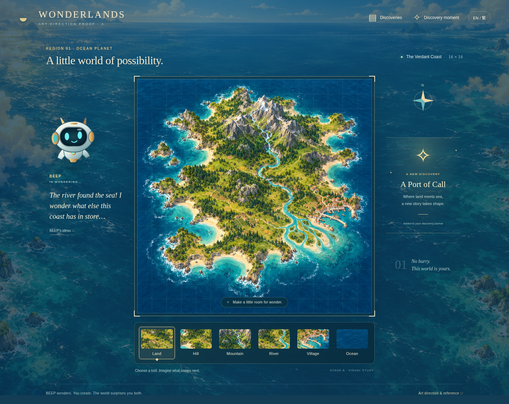

# Wonderlands

**BEEP wonders. You create. The world surprises you both.**

Stage A: one art-direction proof, awaiting the owner's visual approval. This is a responsive presentation prototype, not the implemented game. No Stage B or C work has begun.

## Review on GitHub



[Mobile proof](proof/mobile.png) · [Reference comparison](proof/art-direction-review.png)

The comparison shows the supplied concept, desktop proof, mobile proof, and intentional visual deviations together. These images can be reviewed directly on GitHub without access to the cloud workspace.

## View the proof

From `/workspace/wonderlands`:

```sh
python -m http.server 4173 --bind 0.0.0.0
```

Open through your development environment's supported web viewing route. No package installation or build is required. `index.html` contains the complete screen; `proof/comparison.html` presents the supplied concept next to this proof and its mobile layout. Screenshots are included in `proof/desktop.png` and `proof/mobile.png`.

The six palette selections, desktop cell hover, discovery animation replay, journal dialog, and EN/繁 presentation switch are interactive. Terrain is a fixed illustrated study with a 16 × 16 grid overlay. It does not paint, save, evaluate recipes, or transform settlements. Mobile shows the same scene and tools, with BEEP and the discovery card below the canvas. This intentionally avoids implying implemented mechanics before art approval.

## Art direction

Rich gouache relief terrain, teal ocean and jade landscape, warm ivory and brass accents, regional settlement detail, a continuously winding river, coherent mountain ridge, and irregular foaming coastline. BEEP is an original vector character with a cyan expressive face. The palette sits immediately below the board; the environment continues around the interface.

Intentional differences from the supplied concept: more top-down terrain, quieter grid, restrained ornament, no locked-tool spoilers, and responsive stacked mobile layout. The illustrative regional detail is the visual target; individual buildings and boats are decorative, with no physical simulation planned.

The generated island is a **visual target only**, not a proposed full-map backdrop for the final editable game. After approval, use composable terrain/shore masks, connected river paths, coherent relief assets, and contextual settlement art to preserve this language during edits. Seed decorative variation. Removing terrain must reverse derived appearance. Full arbitrary-map visual fidelity remains an implementation and QA requirement, not something this static proof establishes.

## Validation

`proof/validation.json` records Stage A browser checks only. Capture with `node proof/capture.cjs` when Playwright and Chromium are available in the environment; the app itself has no Node dependencies. The capture script requires a running proof server at port 4173. No gameplay, persistence, performance, or complete localization acceptance is claimed at Stage A.

The unchanged supplied handoff is preserved in `docs/handoff/`. Its GDD governs the bounded v1 scope. After the owner's art approval, implement and test Stages B and C autonomously, without additional scheduled human verification gates. No public deployment is authorized by this proof.
