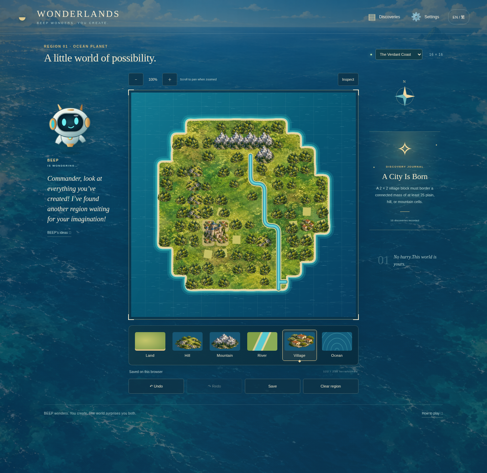

# Wonderlands — dynamic verification and bounded release

Stage A was approved with a dynamic-game condition. The implementation now uses editable cell state and a composable Canvas2D renderer. There is no runtime fixed-map image, concept screenshot, remote art request, or precomposed level. New saves start with 256 ocean cells.

## Reproduction

- `npm test`: the pure-rule suite, using Node's built-in test APIs and assertions. Individual named cases execute directly so the runner reports the real case count.
- `npm run test:browser`: Playwright and Chromium, with a self-managed local server; generates evidence and JSON results.
- `python scripts/package.py`: bundles only runtime files plus the play/deployment/visual notes, verifies ZIP integrity, and asserts that concept-map/proof/evidence images are absent from the release.

See the README for browser-test prerequisites. Test fixtures use isolated browser contexts and never replace a real user's browser save. The performance fixture explicitly verifies that all 256 mountains were loaded before measuring.

The packaged ZIP also receives a separate `node tests/package.cjs` smoke check: extracted into a temporary folder, served under a subpath, loaded in mobile Chromium, edited by touch, saved and reloaded. See `evidence/release-smoke.json`.

Final local result: **17 rule cases passed, 11 browser cases passed, and the extracted-release smoke check passed**, with no skipped or expected-failure cases. Remote CI has not been observed.

## Coverage and evidence

| Area | Executed check |
| --- | --- |
| Every cell | Real pointer strokes across all 16 rows; assert all 256 edited, including corners/edges; reset, undo, redo and keyboard redo |
| Arbitrary layout | Paint sample from blank via pointer events; independent heart and separate-island layouts; 30 seeded connectivity/contour layouts in rule tests |
| Dynamic terrain | Combined shoreline contours, diagonal cardinal continuity, river split, ocean cut, undo restoration and deterministic pixel hashes |
| Settlements | Port and fortress context, valid manual override, reverse mountain edit; 2 × 2 city capability, immediate retroactive upgrade, and reversal after removal |
| Discoveries | All 20 registry predicates reachable in fixtures; first-unlock only, permanent after dismantling, existing-map evaluation on load, valid near-miss hints |
| Progression | Any ten distinct IDs unlock the second region; different theme, separate maps, region switching and reload persistence |
| Desktop | Real mouse drags, palette, journal, inspect/variants, undo/redo, settings, keyboard input, language switch |
| Mobile | Chromium mobile/touch emulation at 390 × 844; touch drag, no page scroll during painting, zoomed and panned hit testing; width checks at 320/390/768/1024 |
| Localization | EN/zh-TW UI, localized earned journal and dialogs, settings persistence, all recipe/hint text in both languages |
| Save safety | Versioned round-trip, legacy migration, corrupt-save recovery copy, quota failure warning with continued editing, export, invalid/cancelled import, confirmed import and reload |
| Rendering | Repeat render pixel hash across reload; actual terrain reversal hash; no static proof/map asset requests; no script/console errors or failed resources |
| Performance | Five full-board redraw samples with all 256 cells mountainous; heap snapshot; event-driven redraw rather than an ongoing Canvas animation loop |
| Accessibility | Named semantic controls, board keyboard editing, touch targets, dialog Escape/focus behavior from native dialogs, reduced-motion setting |

Actual outcomes, timestamps and durations are recorded in [`evidence/browser-results.json`](../evidence/browser-results.json), [`core-results.txt`](../evidence/core-results.txt), and [`performance.json`](../evidence/performance.json). These are results from this machine, not claims about remote CI or physical devices.

## Before and after: actual user events

The browser script begins with an empty new save, selects palette tools and paints using mouse down/move/up. It does not inject the sample map or use a screenshot as a canvas texture.

[Blank sea](../evidence/desktop-before.png) → [Painted landscape](../evidence/desktop-after.png) → [Ocean cut through the land](../evidence/desktop-river-cut.png) → [Reloaded saved world](../evidence/desktop-reloaded.png).

[City after a village is erased](../evidence/city-reverted.png) · [Fortress before removal](../evidence/fortress-before.png) · [Port after mountain removal](../evidence/fortress-after.png).

[Heart layout](../evidence/arbitrary-heart.png) · [Archipelago](../evidence/arbitrary-archipelago.png) · [Amber region](../evidence/region-two.png).

[Same gameplay at mobile width](../evidence/mobile-gameplay.png) · [Real touch-input zh-TW session](../evidence/mobile-zh-TW.png).

## Visual baseline and limitations

Compare the [approved Stage A desktop study](../proof/desktop.png) with the actual gameplay image above. The illustrative assets, textures, companion and environmental composition remain; the dynamic geography has simpler bands and more repeated detail. The full comparison is in [VISUAL-COMPROMISES.md](VISUAL-COMPROMISES.md). Pixel-identical comparison against a fixed concept would not verify arbitrary editable terrain; reversible pixel/state checks and independent layouts do.

The first browser pass exposed diagonal river disconnections and a save-fixture lifecycle problem; both were corrected and the affected checks rerun. A browser console check also exposed a missing favicon, which was added. A stricter mixed-world pixel check then caught Canvas line-cap state affecting wave marks across reloads; each redraw now initializes the relevant Canvas state explicitly. Retained evidence describes the final run, not those superseded failures.

This is a bounded personal/experimental release, with no remaining known critical failure in the executed checks. Local current-instance results are distinct from future CI runs and environment snapshot publication. The static ZIP can be deployed using the included instructions; no public site was deployed. Browser automation is Chromium only, mobile is emulated, and no physical-device, Safari/Firefox, prolonged battery, or commercial compliance certification is claimed. Minor visual repetition, fixed-width rivers, and the less bespoke coast finish remain documented limitations.
